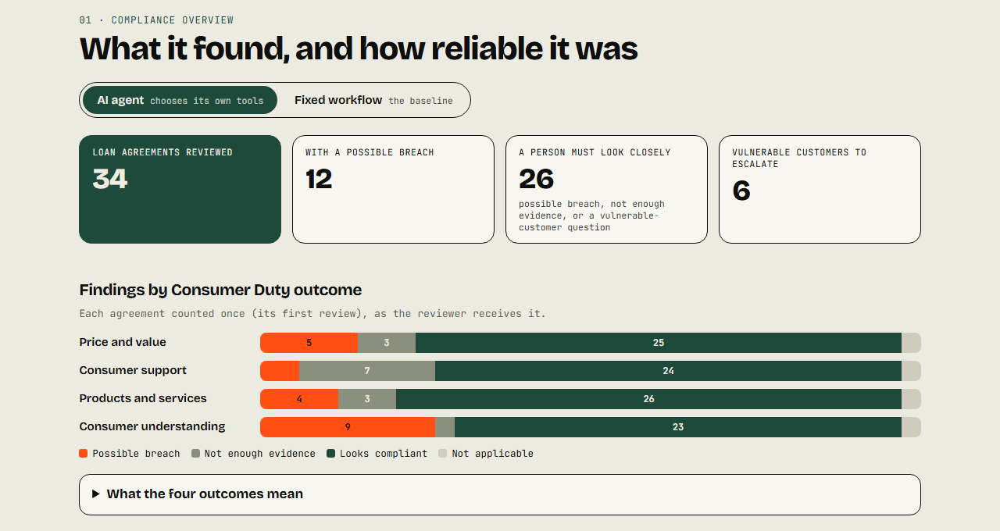
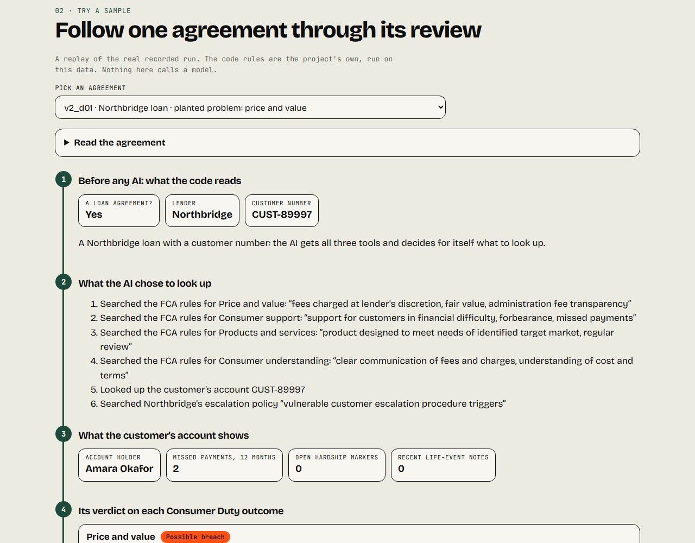
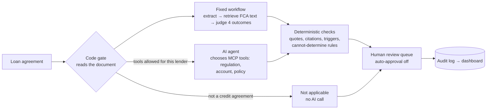
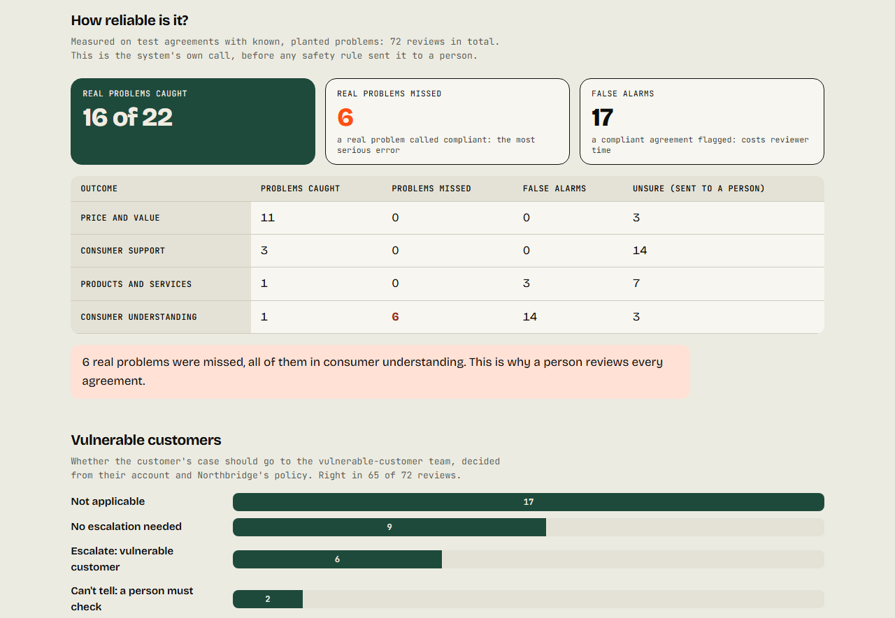

# Banking Compliance Agent

**An AI that reviews UK loan agreements against the FCA Consumer Duty, quotes the regulation behind
every finding, and hands anything uncertain to a person, so a confident wrong answer never reaches a
customer.**

[](https://korede-folarin.github.io/banking-compliance-agent/)
[](https://banking-compliance-agent.streamlit.app)


**[▶ Live demo (always on)](https://korede-folarin.github.io/banking-compliance-agent/)** ·
**[Review app](https://banking-compliance-agent.streamlit.app)** ·
**[Results report](docs/eval_results_v2.md)** ·
**[Case study](https://www.koredefolarin.com/compliance-agent.html)**



## In 30 seconds

- **The problem:** checking a loan agreement against FCA guidance is slow, manual and inconsistent.
  Asking an LLM "is this compliant?" is worse: it answers confidently whether or not it knows.
- **What I built:**
  - retrieval over 344 pages of FCA text;
  - an agent that chooses its own tools over MCP;
  - a deterministic layer that checks every quote and every tool call;
  - a review screen where a person confirms or overrides each verdict.
- **What I measured,** live, on 34 synthetic agreements with planted problems, about $9 of API spend:

| | Fixed workflow (baseline) | AI agent (chooses its tools) |
|---|---|---|
| Real problems caught | **36 of 36** | 16 of 22 |
| Real problems missed | **0** | 6, all in consumer understanding |
| False alarms | 8 | 17 |
| Quotes found in the passage they cite | 540 of 542 | 212 of 216 outcomes fully grounded |
| Required tool calls made | n/a | **100%** |

- **What I did with it:**
  - the agent was worse at verdicts, so verdicts stay with the fixed workflow;
  - its mistakes on escalation and its wasted lookups were all decidable by code, so code now
    decides them before the model runs;
  - every case still goes to a person.

## Try it

**[The always-on demo](https://korede-folarin.github.io/banking-compliance-agent/)** is a static page,
instant, with nothing to install:
1. **Compliance overview.** Switch between the two systems and see what each found and missed.
2. **Try a sample.** Follow one agreement through its real recorded review:
   - what code decides before any AI runs;
   - what the AI looked up;
   - the customer's account;
   - each verdict, with the FCA passage it quotes;
   - the code checking the AI's work;
   - the answer key.
3. **Be the reviewer.** Opens the [Streamlit app](https://banking-compliance-agent.streamlit.app). Open
   a case and confirm or override each verdict. An override without a written reason is refused, and
   so is resolving a case before every item is decided. It's free hosting, so allow about 30 seconds
   if it is waking up.



## How it works



- **Retrieval, not fine-tuning.** One search per Consumer Duty outcome over PRIN 2A, FG22/5 and
  PS22/9 (558 chunks, local embeddings, Chroma). Every claim must quote a passage a reviewer can check.
- **One agent, not a swarm.** The model chooses among three MCP tools, within 8 calls and 6 turns, and
  cites evidence by number (E1, E2…).
- **Code checks the model, not another model:**
  - each quote must really be in the passage it names, including "…"-joined quotes, in order;
  - each outcome may cite only its own search;
  - escalation triggers must match the account's dated facts.
- **Code decides first.**
  - A letter gets no AI call.
  - Another lender's agreement gets no account or policy tools.
  - No lender named, no customer number, or an account in someone else's name gives "cannot
    determine", which always goes to a person.

More detail: [system flow](docs/architecture/system_flow.md) ·
[escalation rules](docs/architecture/escalation_gate.md) · [ARCHITECTURE.md](ARCHITECTURE.md).

## Results



- **The agent chose its tools well but judged worse.**
  - **Tool calls:** every required call was made, with the right customer number every time.
  - **Consumer understanding:** accuracy fell to **0.533**, against the fixed workflow's **0.907**,
    on the same 15 agreements.
  - **Escalation:** right in **50 of 57** runs. All 7 errors were cases that can't be decided, and
    6 of them were called "no escalation", the risky direction. Code now sets those.
- **Disagreement between runs flagged every baseline error, but none of the agent's.**
  - **Baseline:** in 52 of 60 document-outcome pairs all 3 runs agreed, and none of those was wrong.
    All 8 wrong verdicts sat where the runs disagreed.
  - **Agent:** its mistakes repeat in every run (12 of 13).
- **The confidence score isn't a correctness detector.** Right and wrong verdicts differ by at most
  0.0123 in mean confidence, so it is reported, never used to change a verdict.
- **Nothing can skip review yet.** Zero misses on 13 approvals still leaves a 95% upper bound of
  20.6%. A 5% claim would need 59 approved documents, so auto-approval stays off.
- **The checker was checked.** Shown 20 deliberately wrong passages, it never said "supported",
  and it confirmed all 10 right ones.
- **Prompt variants:** two price-and-value prompts scored 15/15 with identical verdicts, so the
  simpler one stays.

Every number links to a report: [results](docs/eval_results_v2.md) ·
[agreement](docs/eval_agreement_eval_raw_main_pass_v2.md) ·
[calibration](docs/eval_calibration_eval_raw_main_pass_v2.md) ·
[negative control](docs/negative_control_report.md) · [variants](docs/eval_variants_report.md).

## Decisions and trade-offs

| Decision | Chosen | Rejected | Evidence |
|---|---|---|---|
| Grounding | RAG over FCA texts | Fine-tuning | Every finding must cite checkable text; 540 of 542 quotes found where cited |
| Who decides | Fixed workflow for verdicts, an agent for escalation, code before both | One agent for everything | The agent was worse on consumer understanding (0.533 vs 0.907) |
| How many agents | One, plus deterministic checks | A multi-agent swarm | The checks that matter are plain code: cheaper and auditable |
| Tools | MCP: regulation, accounts, policy | Plain function calls | Three data domains with different owners |
| Confidence | Retrieval similarity, reported only | Model self-report; a cut-off that replaces verdicts | Right and wrong differ by ≤ 0.0123 |
| Skipping review | Auto-approval off | Auto-approve "easy" outcomes | 95% bound ≥ 20.6% on today's data |
| Ambiguous cases | "Cannot determine" set by rule, always reviewed | Let the model decide | 6 of 7 such cases were called "no escalation" |
| Spending | A hard `--max-usd` cap on every paid command | Trust the estimate | The live evaluation cost about $9 under a $12 cap |

## What went wrong, and what changed

- **A "successful" ingestion was silently broken.** 5,540 chunks of raw PDF bytes, and no error raised.
  I found it by reading sample chunks. Ingestion now runs content checks and a retrieval smoke test,
  and only replaces the live index if they pass (7/7 on the real corpus).
- **Parallel tool calls broke structured output.** Two runs failed with HTTP 400s. Structured calls
  now force a single tool call, and there have been no failures since.
- **The agent missed real breaches.** The live evaluation showed it, so verdicts stay with the fixed
  workflow, and code decides what code can.
- **A paid result was nearly lost.** An output folder didn't exist when a live run tried to save to
  it. The audit log still held the full run, so nothing was paid twice. The folder is now created
  before any paid call, with a regression test.
- **Known, documented, not fixed:** 49 judge calls came back with their arguments wrapped in a
  placeholder key. All recovered on an automatic retry.

## Built for a regulated setting

- **Every run is audit-logged** (`logs/`, JSONL):
  - each model call with its tokens and cost;
  - each tool call with its arguments;
  - each check, whether it passed or failed;
  - per-outcome confidence, and why the case went to review.
- **Human review is enforced in code** (`src/review/store.py`), not just on screen:
  - a named reviewer;
  - a reason for every override;
  - no resolving until every item is decided;
  - an append-only history.
- **A dashboard for two audiences:** plain-language compliance numbers, and technical health
  (failure rate, latency, cost).
- **Docker image, localhost-only:** no API key needed to serve the review app.

<details>
<summary><b>If a bank ran this: what it would add</b></summary>

| Gap today | What a bank needs |
|---|---|
| The reviewer name is free text | Single sign-on: the name comes from the login |
| One person decides and resolves | Four-eyes: a second reviewer approves overrides and resolutions |
| No roles | Reviewer, approver and read-only auditor, with segregation of duties |
| Override reasons are free text | Reason codes plus text, so overrides feed model monitoring |
| A flat queue | Assignment, priority, case age and SLA timers |
| A local append-only file | Tamper-evident storage, a retention policy, and regulator export |
| Synthetic data | Personal-data masking and a log of who viewed what |
| Model details only in the logs | Model, prompt and corpus version on every case, under change control |
| Runs on a laptop | Inside the bank's network, not publicly reachable |

</details>

<details>
<summary><b>Business case</b></summary>

With auto-approval off, the value is reviewer time saved per agreement, net of the time false alarms
cost. Over three scenarios that is **1.3, 8.7 or 20.7 minutes per agreement**, at about $0.11 per
model run.
- **Measured:** false alarms and model cost.
- **Sourced:** salaries.
- **Assumed:** review time and the share of it saved, since no public benchmark exists. The
  conservative case shows no business case.

The document ends with the pilot that would measure the real number:
[docs/business_model.md](docs/business_model.md).

</details>

## Run it locally

```bash
bash init.sh
```

```bash
python -m src.ingestion.ingest
```

```bash
streamlit run src/app.py
```

```bash
python -m pytest tests/
```

- **What each command does:** `init.sh` sets up the environment, `ingest` builds the gated index, the
  Streamlit command opens the review app and dashboard, and pytest runs the 276 offline tests.
- **The API key:** live tests and paid runs need `ANTHROPIC_API_KEY` in `.env` (template:
  `.env.example`). The review app and dashboard need no key.
- **The static demo:** rebuild it with `python -m src.site.build`; it is published from `site/` by
  GitHub Actions.

<details>
<summary><b>Repository map</b></summary>

| Path | What is there |
|---|---|
| `src/agent/` | The fixed workflow, the agentic tool loop, deterministic validation, and the code-level document rules |
| `src/mcp_server/` | The MCP server: regulation search, account lookup, policy search |
| `src/retrieval/`, `src/ingestion/` | Query engine; gated ingestion with content checks |
| `src/review/` | Review cases, the decision store with its rules, and the sample replay |
| `src/monitoring/` | Audit log, dashboard data, plain-language overview |
| `src/evaluation/` | Evaluation harnesses: agreement, calibration, claim checks, negative control |
| `src/app.py`, `src/pages/` | Streamlit review app, dashboard, Try a sample |
| `site/`, `src/site/` | The always-on static demo and its builder |
| `docs/` | Every evaluation report, the architecture diagrams, the business model |
| `tests/` | 316 tests (276 offline, 40 against the live API) |

</details>

## Stack

Claude API (Anthropic SDK) · Pydantic and `instructor` · LlamaIndex · ChromaDB ·
`bge-small-en-v1.5` local embeddings · MCP · Streamlit · Docker · GitHub Actions.

## Honest scope

**What this is:**
- 34 synthetic loan agreements with planted problems, against a Consumer-Duty-only corpus.
- Enough to catch real bugs and to compare designs fairly.

**What it isn't:**
- **Not evidence about real agreements.**
- **No affordability judgment:** CONC isn't indexed.
- **Not a production banking system.**
- **No real customer data** is used anywhere.

Where a real deployment would need more, it says so above instead of implying it.

**Built by [Korede Folarin](https://www.koredefolarin.com):** ML and AI engineer with three years in
regulated banking (credit risk, KYC, compliance).
