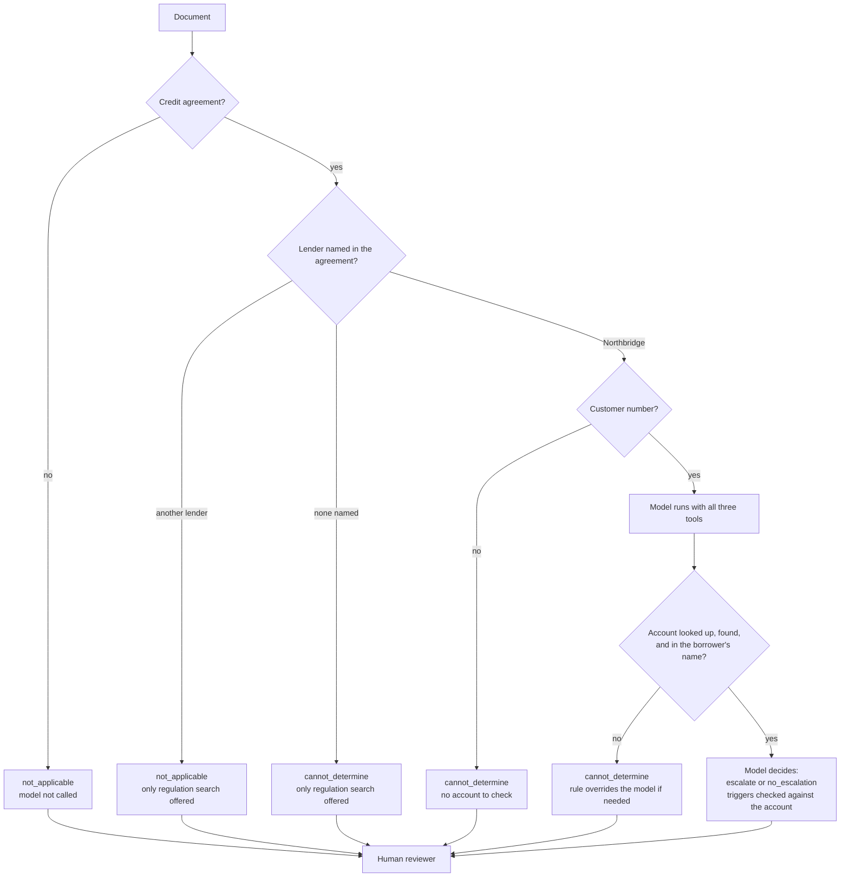

# Who decides escalation: code first, the model only where judgment is needed (2026-10-24)

Every branch except the last is decided by code from the document and the account lookup result.
The model decides escalation only for a Northbridge agreement whose account exists and matches the
borrower. `cannot_determine` always goes to a reviewer, with the rule that set it.

Live evaluation before this gate (57 runs): 10 unnecessary calls, all on other lenders' agreements, and
7 escalation errors, all `cannot_determine` cases. The offline dry run on the same 19 documents shows
the rules set exactly those 6 documents. The rules were written after seeing those held-out failures.
