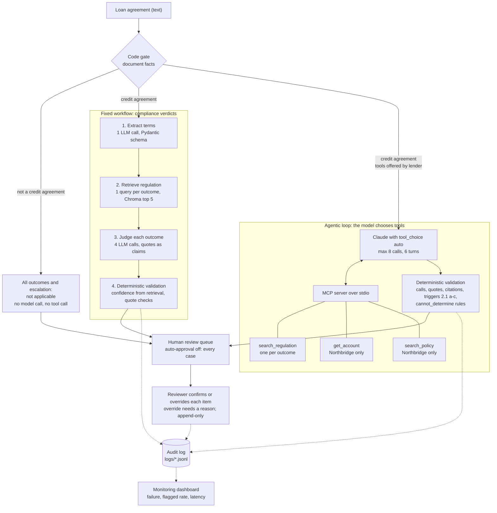

# How a document flows through the system (as built, 2026-10-24)

The fixed workflow (top) produces the evaluated compliance verdicts. The agentic loop (middle) chooses
its own MCP tools. The code gate runs before any model call. Everything ends in the human review queue,
and every step writes to the audit log that the dashboard reads.

